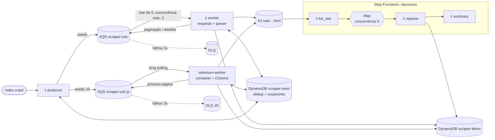

# scrapeflow

[](https://github.com/jv-taliani/scrapeflow/actions/workflows/ci.yml)

Pipeline de scraping distribuído e serverless na AWS. Um producer enfileira URLs no SQS, workers Lambda baixam as páginas e guardam o HTML bruto no S3 e o dado estruturado no DynamoDB. Um worker Selenium em container cuida das páginas que dependem de JavaScript, e uma Step Function reprocessa o histórico salvo sem baixar nada de novo. Tudo roda de graça no LocalStack e cabe no free tier da AWS real.

Os alvos são sites feitos para treinar scraping: [books.toscrape.com](https://books.toscrape.com) (HTML estático) e [quotes.toscrape.com/js](https://quotes.toscrape.com/js/) (renderizado por JavaScript).

## Arquitetura



| Peça | Arquivo |
|---|---|
| Modelos (`CrawlTask`, `Book`, `Quote`) | `src/scraper/models.py` |
| Cliente HTTP com retry, rotação de UA, proxy e throttle | `src/scraper/http.py` |
| Parsers (registry plugin) | `src/scraper/parsers/` |
| S3 + DynamoDB (upsert idempotente, dedup, orçamento de páginas) | `src/scraper/storage.py` |
| Fluxo parse → upsert → dedup → enfileira, compartilhado por todos os workers | `src/scraper/pipeline.py` |
| Lambdas | `src/scraper/handlers/` |
| Worker Selenium + modo híbrido | `selenium_worker/main.py` |
| Infra | `infra/*.tf`, `infra/stepfunctions/reprocess.asl.json` |

## Decisões técnicas e trade-offs

**SQS + Lambda.** A fila desacopla a descoberta de URLs do download, e cada página é uma mensagem. Se uma falha, só ela volta para a fila. O worker devolve `batchItemFailures`, então uma URL ruim não derruba as outras quatro do lote. A Lambda escala sozinha e não cobra nada parada, o que serve bem para crawls esporádicos.

**`maximum_concurrency = 2` como rate limit.** O event source mapping limita quantas Lambdas consomem a fila ao mesmo tempo. Somado ao throttle de 1 s por domínio dentro de cada Lambda, isso dá no máximo ~2 req/s no site, sem precisar de um rate limiter distribuído. Não usei *reserved concurrency* porque contas novas têm limite total baixo, e reservar parte dele pode bloquear outras funções.

**Selenium fora da Lambda.** Chrome headless numa Lambda exige layer de ~150 MB, mais memória (custo) e cold start de vários segundos. Como container com long polling, ele usa o mesmo pacote `scraper` (parsers, storage e pipeline) e só troca a forma de baixar a página.

**DynamoDB em vez de RDS.** RDS não tem camada Always Free e cobra por hora ligado. DynamoDB on-demand cobra por requisição, e um crawl inteiro custa frações de centavo. O modelo de acesso é sempre por chave (`pk = fonte#id`), então não faz falta um banco relacional.

**Idempotência.** O `v#latest` de cada item é gravado com `ConditionExpression: attribute_not_exists(pk) OR content_hash <> :h`. Se o conteúdo não mudou, nada é escrito, mesmo se a mesma mensagem for entregue duas vezes (o SQS garante *at-least-once*). Quando o preço muda, uma linha `price#<timestamp>` registra o histórico.

**Dedup.** Antes de enfileirar, cada URL passa por um `put_item` condicional em `scraper-seen` (`url#<run_id>#<sha256>`, TTL de 1 dia). Sem isso, as 50 páginas de listagem apontariam para os mesmos detalhes várias vezes. O `run_id` faz parte da chave para que um segundo crawl no mesmo dia baixe tudo de novo.

**Orçamento por run.** Um contador atômico em `scraper-seen` (`run#<run_id>`) para o crawl em `MAX_PAGES` downloads, e `MAX_DEPTH` corta a profundidade. Os dois existem para um bug não estourar o free tier.

**DLQ.** Cada fila tem DLQ com `maxReceiveCount = 3`. Uma URL que dá 404 é tentada 3 vezes e depois fica parada na DLQ para inspeção. O `visibility_timeout` é de 180 s (6× o timeout de 30 s do worker), como a AWS recomenda para filas ligadas a Lambda.

**Retry em camadas.** Dentro da requisição, o `HTTPAdapter` repete até 3 vezes com backoff em 429/5xx, respeitando `Retry-After`. Entre requisições, se o erro persistir, a mensagem volta para a fila e o SQS tenta de novo mais tarde.

**Reprocessamento separado do download.** O HTML bruto fica no S3 por 30 dias. Se um parser tinha bug, a Step Function relê esse HTML e corrige o DynamoDB sem tocar no site. O `Map` roda com concorrência 5, e o `Catch` transforma a falha de uma página em uma linha no resumo em vez de abortar a execução.

### Padrão híbrido: Selenium só para abrir a sessão

Com `--bootstrap-session`, o worker JS abre só a primeira página no Chrome, copia cookies e User-Agent para uma `requests.Session`, fecha o navegador e baixa o resto por HTTP puro. Se a sessão expirar (401/403), ele abre o Chrome de novo.

**Compensa quando** o JavaScript só é necessário para obter a sessão (desafio anti-bot, login, cookie de consentimento) e o conteúdo depois vem no HTML ou numa API. Cada página por `requests` é dezenas de vezes mais rápida e leve que no Chrome.

**Não compensa quando** cada página monta o conteúdo no navegador sem que ele exista no HTML. Aí o `requests` recebe uma casca vazia.

No quotes.toscrape as citações vêm num `var data = [...]` dentro de um `<script>`. Por isso o parser `quotes_js` lê o DOM renderizado quando ele existe e, se não, esse JSON. Os dois caminhos geram exatamente os mesmos itens, e há um teste que garante isso.

## Rodando localmente

Precisa de Docker, Terraform ≥ 1.6, Python 3.12 e `zip`.

1. **Token do LocalStack.** Desde março de 2026 a imagem `localstack/localstack` exige `LOCALSTACK_AUTH_TOKEN`, e o plano gratuito serve. Crie uma conta em [app.localstack.cloud](https://app.localstack.cloud), copie o token em *Auth Tokens* e coloque no `.env`:
   ```bash
   cp .env.example .env
   # edite .env e preencha LOCALSTACK_AUTH_TOKEN=...
   ```
   O `.env` está no `.gitignore`. Não coloque o token no `.env.example`.

2. **Ambiente Python:**
   ```bash
   python3 -m venv .venv
   .venv/bin/pip install -r requirements-dev.txt -e .
   ```

3. **Subir, empacotar e fazer o deploy:**
   ```bash
   make up             # LocalStack em localhost:4566
   make build          # build/lambda.zip com código + dependências
   make deploy-local   # tflocal apply (workspace "local")
   ```

4. **Rodar:**
   ```bash
   make crawl SOURCE=books   # imprime o run_id
   make inspect              # itens por fonte, objetos no S3, mensagens nas filas e DLQs
   make crawl-js             # sobe o selenium-worker e enfileira o quotes_js
   SELENIUM_WORKER_ARGS=--bootstrap-session make crawl-js   # modo híbrido
   make reprocess SOURCE=books RUN_ID=<run_id do crawl>
   ```

5. **Testes:**
   ```bash
   make lint       # ruff + mypy strict
   make test       # unitários (moto, requests-mock, fixtures HTML salvas)
   make test-int   # ponta a ponta contra o LocalStack já deployado
   ```

6. `make down` desliga tudo. O LocalStack guarda o estado em memória, então depois de um `make up` novo é preciso `make deploy-local` de novo. Se o Terraform reclamar de recursos que não existem mais, apague `infra/terraform.tfstate.d/local/`.

O CI (`.github/workflows/ci.yml`) roda lint e testes unitários com cobertura mínima de 80% em parsers e storage. Ele também faz o deploy no LocalStack e roda o teste de integração. Para o job de integração funcionar, cadastre o secret `LOCALSTACK_AUTH_TOKEN` no repositório.

## Deploy na AWS real sem custo

Lambda, SQS, DynamoDB e Step Functions têm cota mensal **Always Free** bem acima do que este projeto usa: um crawl com `max_pages = 30` gera algumas centenas de requisições. O S3 não entra no Always Free, mas alguns MB de HTML por 30 dias custam frações de centavo. As regras do free tier mudam com o tempo, então confira a [página oficial](https://aws.amazon.com/free/) antes.

Proteções que já vêm no Terraform:

- **AWS Budget de US$ 1/mês**, com e-mail aos 50% gastos e quando a previsão passa de 100%. Só é criado com `environment = "aws"`, e o Terraform recusa o apply sem `alert_email`.
- **Logs** com retenção de 3 dias e **`raw/`** expirando em 30 dias.
- **Sem VPC, NAT Gateway, RDS, EC2, ECS, Fargate ou Batch.** DynamoDB em PAY_PER_REQUEST.
- **State separado:** `deploy-aws` usa o workspace `aws`, isolado do `local`.

```bash
cp infra/envs/aws.tfvars.example infra/envs/aws.tfvars   # preencha alert_email (arquivo ignorado pelo git)
make build
make deploy-aws                     # mostra o plano e pede "yes"
make crawl SOURCE=books ENV=aws     # usa suas credenciais AWS normais (perfil/env)
make inspect ENV=aws
make reprocess SOURCE=books RUN_ID=... ENV=aws
make destroy-aws                    # ao terminar, apaga tudo (inclusive o bucket)
```

Confirme o e-mail de assinatura do Budget que a AWS manda, senão o alerta não chega.

O worker Selenium não roda na AWS. Para usar contra filas reais, rode o container localmente com as suas credenciais e as URLs dos outputs do Terraform, sem `AWS_ENDPOINT_URL`.

## Adicionando uma nova fonte

1. Crie `src/scraper/parsers/minha_fonte.py`:
   ```python
   from scraper.models import CrawlTask, Item
   from scraper.parsers import register
   from scraper.parsers.base import Parser, ParseResult


   @register
   class MinhaFonteParser(Parser):
       source = "minha_fonte"
       seeds = ("https://exemplo.com/lista",)
       requires_js = False  # True manda para a fila do Selenium
       wait_for = None  # seletor CSS que o Selenium espera aparecer

       def parse(
           self, html: str, task: CrawlTask
       ) -> (
           ParseResult
       ): ...  # devolva items (subclasses de Item) e next_tasks (self.child(task, url, kind))
   ```
2. Se precisar de campos próprios, crie o modelo em `models.py` herdando de `Item`. Sobrescreva `tracked_price()` para ganhar histórico de preço.
3. Importe o módulo no fim de `src/scraper/parsers/__init__.py`.
4. Salve uma página real em `tests/fixtures/` e escreva o teste do parser.
5. `make build deploy-local && make crawl SOURCE=minha_fonte`.

Nenhuma fila, tabela ou Lambda nova é necessária.

## Exemplo de saída

Item em `scraper-items` (`description` cortada):

```json
{
  "pk": "books#a-light-in-the-attic_1000",
  "sk": "v#latest",
  "source": "books",
  "item_id": "a-light-in-the-attic_1000",
  "title": "A Light in the Attic",
  "price": 51.77,
  "currency": "GBP",
  "availability": 22,
  "rating": 3,
  "upc": "a897fe39b1053632",
  "category": "Poetry",
  "image_url": "https://books.toscrape.com/media/cache/fe/72/fe72f0532301ec28892ae79a629a293c.jpg",
  "url": "https://books.toscrape.com/catalogue/a-light-in-the-attic_1000/index.html",
  "raw_s3_key": "raw/books/2026-10-28T13-31-13Z/8496bf8dba16cd78cb4e7d374e85bc7a20453a2f4506d1a96495b5b48b2feaf1.html",
  "content_hash": "ce39760fb00bef387fdfad5811ed7b773ddefe58dde4461e679dfd024bd5ef17",
  "run_id": "2026-10-28T13-31-13Z",
  "updated_at": "2026-10-28T13:31:19.659462+00:00"
}
```

Saída de `make reprocess` com uma página corrompida no meio:

```json
{
  "status": "SUCCEEDED",
  "output": {
    "source": "books",
    "prefix": "raw/books/2026-10-28T14-00-41Z/",
    "pages": 51,
    "ok": 50,
    "error": 1,
    "created": 0,
    "updated": 0,
    "unchanged": 47,
    "errors": [{"key": "raw/books/2026-10-28T14-00-41Z/quebrado.html", "error": "ValueError"}]
  }
}
```

> *Print/GIF da execução da Step Function: adicionar em `docs/stepfunctions.png`.*

## Limitações e próximos passos

- **Status do Selenium:** o Selenium não expõe o status HTTP, então o worker JS grava `status_code = 200`. Dá para capturar o status real via CDP (`Network.responseReceived`).
- **Orçamento de páginas:** retentativas consomem o orçamento de novo, então uma URL quebrada gasta até 3 das `MAX_PAGES` páginas.
- **Throttle por processo:** o throttle vale dentro de cada Lambda. O limite global depende de `maximum_concurrency`. Para vários workers distintos no mesmo domínio, faria sentido um token bucket no DynamoDB.
- **Tamanho do Map:** o `list_raw` devolve todas as chaves no payload da Step Function (limite de 256 KB, uns 2 mil objetos). Para históricos maiores, o caminho é um *Distributed Map* lendo direto do S3.
- **Selenium na AWS:** o worker roda só como container local. Na AWS ele precisaria de um host, o que sai do free tier.
- **Observabilidade:** faltam métricas (EMF/CloudWatch) de páginas por minuto e erros por fonte, e um alarme na profundidade da DLQ.
- **`robots.txt`:** não há respeito automático. Os sites alvo existem para treino, mas uma fonte real pediria isso.
